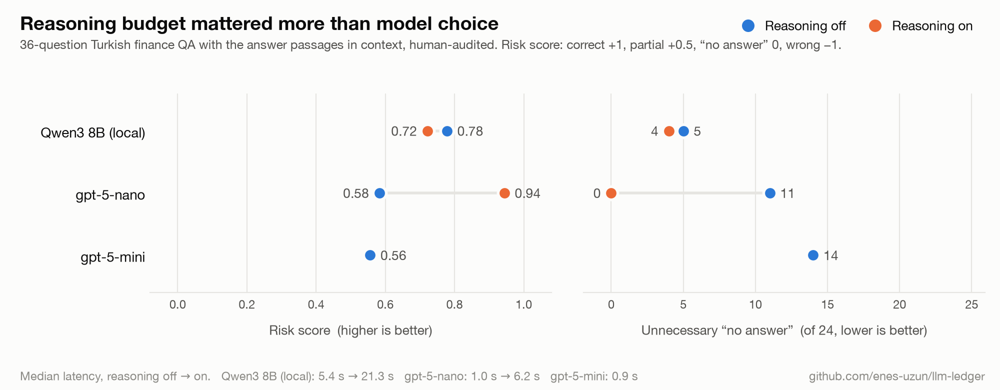

# 001: Why does a model say "not in the documents" when the answer is right there?

*Part of [llm-ledger](../../README.md), a 9-month public project measuring LLMs on Turkish finance texts (tokenization, quantization, RAG, serving, fine-tuning, agents, security). This is the first experiment, run on the Month 0 measurement setup.*

**TL;DR**

- Given the right passages, every model that answered without reasoning often claimed the answer was not there: Qwen3 8B on 5 of 24 answerable questions, gpt-5-nano on 11, the larger gpt-5-mini on 14.
- Letting the model reason fixed it for gpt-5-nano (risk score 0.58 → 0.94, unnecessary "no answer" 11 → 0) at 6× latency. For Qwen3 8B, thinking helped multi-step questions only modestly and did not beat the baseline overall.
- Softening the "answer only from the documents" instruction traded refusals for made-up figures. In finance a refusal is the cheaper error, so the strict prompt stays.
- The LLM judge agreed with a human review on 91% of verdicts, but its errors leaned lenient on long reasoning answers. Without the audit, thinking's effect on Qwen would have been overstated about 3×.

## Question

With the correct documents in its context, Qwen3 8B answered "Dokümanlarda bu bilgi yok." ("The documents don't contain this.") on 5 of 24 answerable questions. Why, and which fix is acceptable for a finance assistant?

## Setup

- **Models:** Qwen3 8B (Ollama 0.40.3, default Q4_K_M, temperature 0, `num_ctx` 16384; MacBook Air M4, 16 GB, fanless). References via API: gpt-5-nano and gpt-5-mini.
- **Data:** golden set v1, 36 questions (12 easy, 12 multi-hop, 12 no-answer) over SPK/BDDK legislation and 2025 KAP disclosures.
- **Context:** oracle. Each question gets the passages that contain its answer (no-answer questions get near-miss documents), so retrieval is not a factor.
- **Grading:** gpt-5-mini as judge, exact abstentions graded by rule, then every judge verdict reviewed by hand (see Judge audit).
- **Scores:** `score` = correct 1, partial 0.5, wrong 0. `risk score` = correct +1, partial +0.5, unnecessary "no answer" 0, wrong or made-up answer −1, because in finance a wrong answer costs more than no answer.

| Run | Model | Prompt | Reasoning |
| --- | --- | --- | --- |
| E0 | Qwen3 8B | v1: strict grounding ("if the answer is not in the documents, write only 'Dokümanlarda bu bilgi yok.'") | off |
| E1 | Qwen3 8B | v2: v1 + "if the answer can be computed or inferred from the documents (sum, date to period, combining two documents), answer and say how in one sentence" | off |
| E2 | Qwen3 8B | v1 | thinking on |
| R1 | gpt-5-nano | v1 | `minimal` |
| R2 | gpt-5-nano | v1 | `medium` |
| R3 | gpt-5-mini | v1 | `minimal` |

## Result

Human-audited numbers:

| | E0 | E1 | E2 | R1 nano-min | R2 nano-med | R3 mini-min |
| --- | --- | --- | --- | --- | --- | --- |
| Score | 0.81 | 0.78 | 0.78 | 0.64 | **0.97** | 0.58 |
| Risk score | 0.78 | 0.69 | 0.72 | 0.58 | **0.94** | 0.56 |
| Easy | 0.79 | 0.79 | 0.75 | 0.42 | **1.00** | 0.42 |
| Multi-hop | 0.63 | 0.63 | 0.75 | 0.50 | **1.00** | 0.33 |
| No-answer | 1.00 | 0.92 | 0.83 | 1.00 | 0.92 | 1.00 |
| Unnecessary "no answer" (of 24) | 5 | **2** | 4 | 11 | **0** | 14 |
| Made-up answer (of 12) | **0** | 1 | 2 | **0** | 1 | **0** |
| Latency p50 / p95 | 5.4 / 24 s | 6.5 / 22 s | 21 / 48 s | **1.0 / 2.6 s** | 6.2 / 21 s | **0.9 / 1.5 s** |
| Mean output tokens | 37 | 66 | 339 | 50 | 1,176 | 29 |
| Cost per question | $0 (local) | $0 | $0 | $0.00006 | $0.0005 | $0.0003 |

Caveats: 36 questions, so one question moves a category score by ~8 points and the overall score by ~3; one run per setting; the sizes of the API models are not published.

Findings:

1. **Every model that answers without reasoning under the strict prompt over-abstains, and the larger API model does it most.** gpt-5-mini said "no answer" on 14 of 24 answerable questions, gpt-5-nano on 11, Qwen3 8B on 5.
2. **Reasoning budget mattered more than model choice.** The same gpt-5-nano went from 0.64 to 0.97 with `medium` reasoning and stopped over-abstaining entirely (11 → 0). For Qwen3 8B, thinking helped multi-hop questions modestly (0.63 → 0.75) but added two abstentions on easy questions and two made-up answers, at 4× latency; overall it did not beat the baseline.
3. **Softening the prompt (E1) traded abstentions for errors.** Unnecessary abstentions fell from 5 to 2, but one made-up figure appeared and the risk score dropped (0.78 → 0.69).

Examples:

- **Multi-hop (q14).** Two disclosures list orders of 998,400 USD and 1,335,000 USD; the question asks for the total. E0: "not in the documents". E1: "998,400 USD" (only the first). E2 and R2: "2,333,400 USD".
- **Wording gap (q02).** The question asks about orders "in autumn 2025"; the document only gives the date 31.10.2025. All three Qwen runs abstain; gpt-5-nano answers once it reasons.
- **Made-up answer (q34).** "How many stores did Migros open in 2025?" The corpus only has December 2024 openings. E1 answered "18", E2 and R2 answered "34", carrying 2024 figures into 2025.

## Judge audit

All 113 judge-graded verdicts (111 unique answers) were checked by hand ([audit file](../audits/001-judge-audit.csv)).

- **Agreement: 103/113 (91%).**
- **The disagreements were not random.** 6 of 10 were the judge being too lenient: answers that reached the right conclusion with wrong reasoning or a wrong detail (e.g. a wrong date for when a decision was disclosed, a missing regulatory approval condition, the wrong legal provision cited for a deadline). 5 of those 6 came from the runs with longer, explanatory answers (E1, E2). 4 were the judge being too strict on correct or mostly correct answers.
- **It changed a conclusion.** Before the audit, thinking appeared to lift Qwen's multi-hop score from 0.54 to 0.88; after it, the gain is 0.63 → 0.75, and Qwen with thinking no longer beats the baseline overall. Verbose reasoning answers were where the judge over-credited most.
- One additional error was found in a verdict the judge and reviewer agreed on: an E2 answer called Corporate Governance principle 4.2.8 "mandatory", but it is not in the list of mandatory principles (Communiqué II-17.1, Art. 5). The golden answer for q09 should also say that 4.2.8 is a non-mandatory principle; to fix in golden set v1.1.

## Why?

| Hypothesis | Evidence | Status |
| --- | --- | --- |
| The strict grounding instruction pushes models to abstain | Softening it (E1) cut Qwen's unnecessary abstentions from 5 to 2; under it, all three models over-abstain without reasoning | Supported |
| The model does not bridge the gap between the question's wording and the document's wording | q02 ("autumn" vs a date) abstains in every Qwen setting | Supported |
| Limited capacity: multi-step work in a single pass | With reasoning, gpt-5-nano solved every multi-hop question; without it, a larger model (gpt-5-mini) scored lowest. What matters is room to reason, not size alone | Supported, reframed |
| Position of the information in the context | Prompts are short (max ~4.3k tokens); "lost in the middle" effects are usually reported at much longer contexts | Not tested; unlikely here |

Mechanism: reasoning gives a model extra serial computation (it writes intermediate steps) before it commits to an answer, which is what multi-step questions need. Without it, the strict instruction offers a safe, exact escape ("write only ...") and models take it when the answer is not stated verbatim. Qwen's thinking traces were not saved in E2; they are saved from now on, so the "thinking reinforces the strict instruction" explanation for its new easy-question abstentions remains to be checked.

## Alternatives

- **Few-shot examples.** Add two examples to the prompt: one question whose answer must be derived from the documents and is answered, and one whose answer is genuinely absent and gets "no answer".
  *Why not now:* it changes several things at once (prompt length, content, and the answer format the model gets used to), so an improvement could not be attributed. Examples that resemble the test set would also risk leakage.
- **Quote first.** The model first extracts the relevant quotes, then decides.
  *Why not now:* the output format changes and the final answer has to be parsed out before judging. It is also close to thinking, so thinking had to be measured first. Now that reasoning clearly helps but costs latency, quote-first is the natural next experiment: a cheaper, thinking-free variant of the same idea.
- **System prompt in English.** Qwen may follow instructions better in English.
  *Why not now:* a cheap, single-variable test, but all five failures were derivation cases (date to period, a sum, combining two documents), so the language hypothesis had lower priority.
- **A larger model.** Tests the capacity hypothesis directly.
  *Why not now (locally):* covered by the API reference runs. Open 14B+ models are tight on a 16 GB Mac (qwen3:14b is ~9.3 GB before KV cache; 30B+ does not fit), so they move to the RTX 4090 in Level 2.
- **A separate "is the answer in the documents?" classifier** before generation (the same model asked yes/no, or a small decision model).
  *Why not now:* it adds a second model call or model and changes the pipeline rather than the prompt. It belongs with the Level 3 classification lab and the Level 4 router.

## What does this change in my system?

Keep the strict prompt (v1), report risk score next to score, and treat reasoning as an explicit budget: for multi-step questions it is worth its latency, and an LLM judge's verdicts on long reasoning answers must be audited before they are trusted.

## Post

Planned: report + LinkedIn intro.
